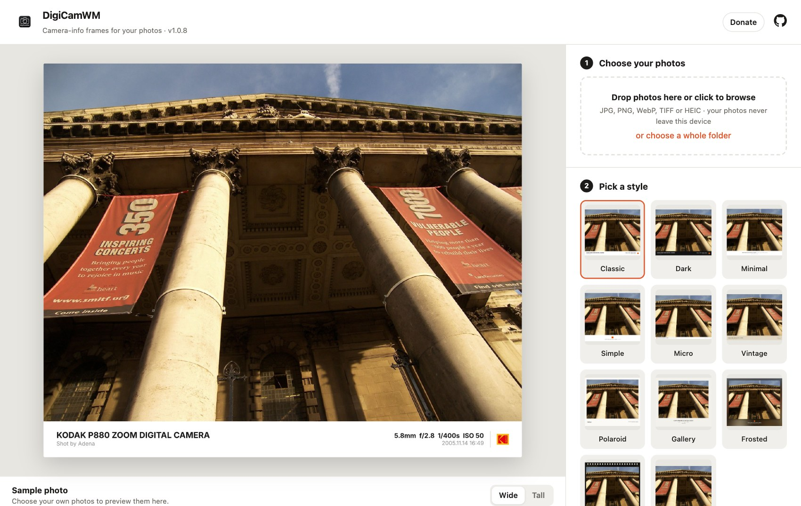

# DigiCamWM

🇬🇧 English | [🇮🇩 Bahasa Indonesia](README.ID.md)

DigiCamWM adds a frame to your photos showing which camera took them and the settings used, like `5.7mm f/1.5 1/121s ISO 125`, plus the date and your name.



## Get it

**Use it in your browser.** Nothing to install: **https://gvoze32.github.io/digicamwm/**
Your photos stay on your device and are never uploaded.

**Or download the app** from the [Releases page](https://github.com/gvoze32/digicamwm/releases/latest). The app is better for a whole folder of photos.

| Your device             | Download                                          |
| ----------------------- | ------------------------------------------------- |
| Windows                 | the `.exe` file                                   |
| Mac with an Apple chip  | the `.dmg` file with `aarch64` in its name        |
| Mac with an Intel chip  | the `.dmg` file with `x64` in its name            |
| Linux                   | the `.AppImage` or `.deb` file                    |
| Android                 | the `.apk` file                                   |

## How to use

1. **Choose your photos.** In the browser, drop them in or pick a folder. In the app, pick a folder.
2. **Pick a style.** The big preview updates as you click.
3. **Type your name** if you want it on the frame. You can skip this.
4. **Press "Frame".**
   - App: the new photos go into a folder called `DigiCamWM` inside your photo folder. Press "Open folder" to see them.
   - Browser: press "Download". If you chose more than one photo, you get them all in one ZIP file.

Your original photos are never changed.

## Styles

| Style      | What it looks like                                         |
| ---------- | ---------------------------------------------------------- |
| Classic    | White bar under the photo, camera on the left, logo on the right |
| Dark       | The same layout on a black bar                             |
| Minimal    | One small line of text, no logo                            |
| Simple     | Brand logo in the middle with the camera name under it     |
| Micro      | A very thin strip with everything on one line              |
| Vintage    | Old paper with typewriter text                             |
| Polaroid   | White instant-photo border with your name in big letters   |
| Gallery    | Wide border like a framed museum print                     |
| Frosted    | Rounded photo on a blurred copy of itself                  |
| Film Strip | Black 35mm film edges with sprocket holes                  |
| Date Stamp | Orange date in the corner, like an old compact camera      |

## Good to know

- **Files you can use:** JPG, PNG, WebP, TIFF, and HEIC (iPhone photos).
- **Missing camera details?** The camera details come from the photo file itself. Apps like WhatsApp and Instagram, and screenshots, usually remove them. In that case the frame shows only what is left.
- **Logos:** Apple, Canon, DJI, Fujifilm, GoPro, Hasselblad, Kodak, Konica Minolta, Leica, Nikon, Olympus, Panasonic, Pentax, Samsung, Sigma and Sony get their logo. Other brands get their name in text.
- **Saved files:** PNG photos stay PNG. Everything else is saved as JPG. The new file does not keep the original camera data.

### Mac says "DigiCamWM is damaged and can't be opened"

The app is not signed by Apple. Open the **Terminal** app, paste this line, and press Enter:

```bash
xattr -c /Applications/DigiCamWM.app
```

Then open DigiCamWM again.

## For developers

You need [Node.js](https://nodejs.org/) 20+, [Rust](https://rustup.rs/), and the [Tauri prerequisites](https://tauri.app/start/prerequisites/). Then:

```bash
rustup target add wasm32-unknown-unknown
cargo install wasm-bindgen-cli --version 0.2.127
npm install

npm run dev         # desktop app
npm run web:dev     # browser version at http://localhost:1420
npm run build       # desktop installer
npm run web:build   # static site in dist/
cargo test --workspace
```

How the code is laid out:

- `crates/core`: reads the photo, draws the frame, and saves the result. It holds the styles (`src/designs/`), fonts and logos. The app and the browser version both use it.
- `crates/wasm`: makes the core run in the browser.
- `src/`: the desktop app's commands (folder batch, update check).
- `ui/`: the screens (React), used by the app and the browser version.

To add a style, write a function in `crates/core/src/designs/` and add it to the list in `designs/mod.rs`. It then appears in both versions.

## License

ISC. See [LICENSE](LICENSE). The bundled fonts (Inter, JetBrains Mono, DM Serif Display, DSEG) use the SIL Open Font License; their license files are in `crates/core/fonts/`.
